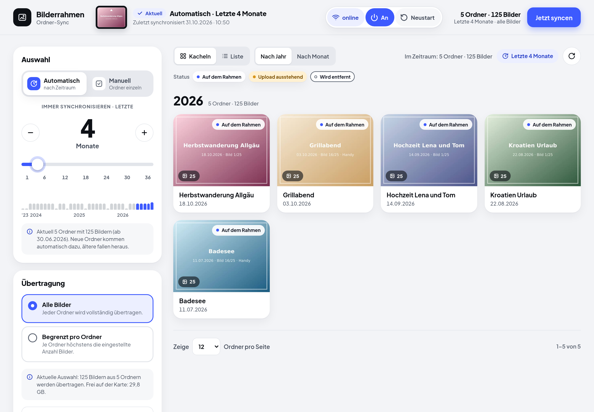
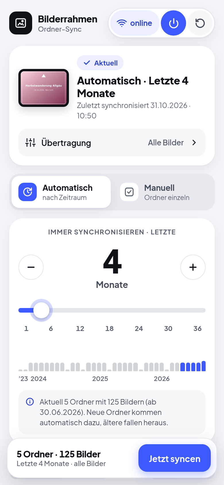
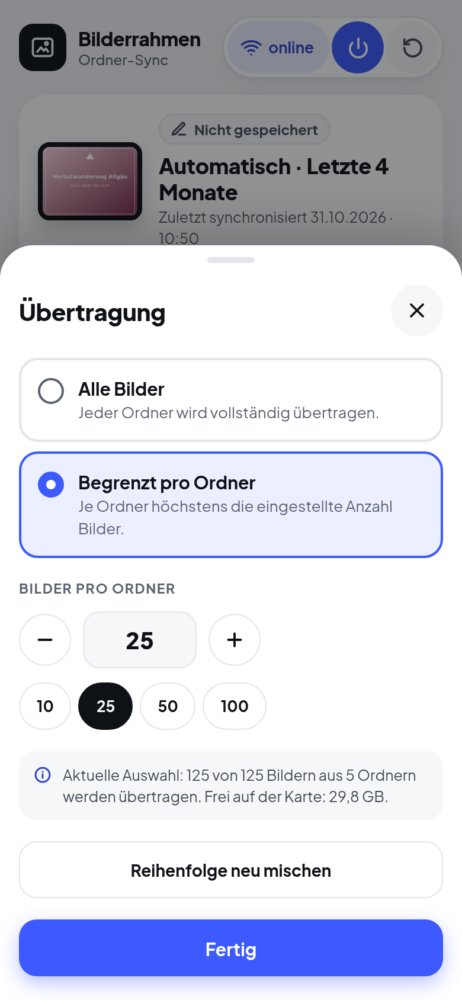
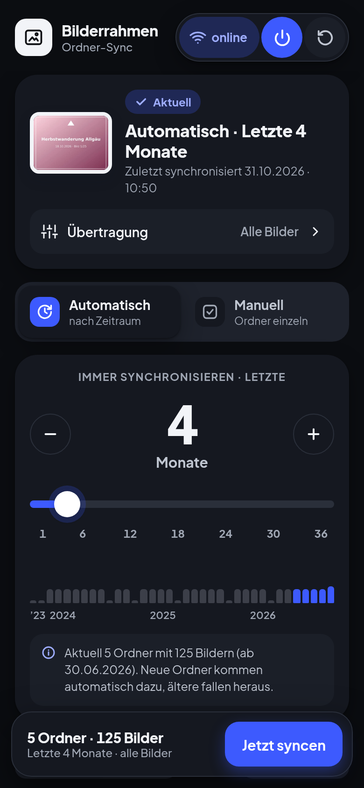
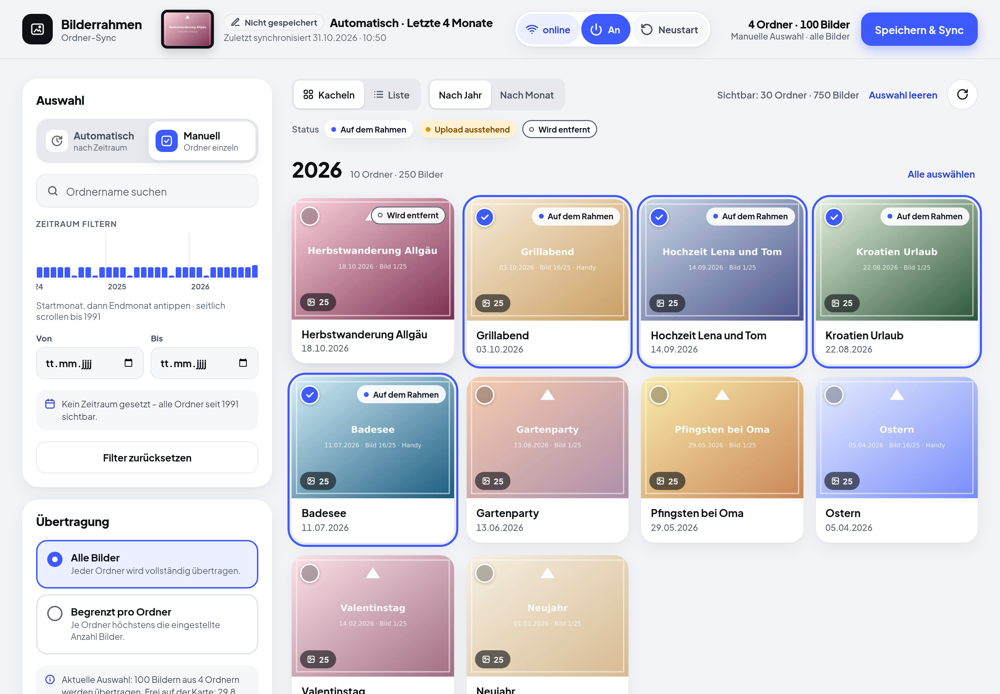

<div align="center">

# Bilderrahmen Sync

[](https://github.com/jb-io/photoframe-sync/actions/workflows/docker-publish.yml)
[](https://hub.docker.com/r/jbiohub/photoframe-sync)
[](https://hub.docker.com/r/jbiohub/photoframe-sync/tags)
[](https://hub.docker.com/r/jbiohub/photoframe-sync/tags)
[](LICENSE)

**Deine Foto-Ordner vom Netzlaufwerk auf den digitalen Bilderrahmen. Automatisch, kabellos, jeden Tag ein bisschen anders.**



</div>

Du sortierst deine Fotos in Ordner wie `2026-08-22_Kroatien_Urlaub`? Dann wählst du hier per Fingertipp, welche davon auf den Bilderrahmen kommen. Bilderrahmen Sync schneidet die Bilder passend zu, mischt sie und schickt sie per WLAN an die **Toshiba FlashAir** im Rahmen. Ist der Rahmen gerade aus, holt die App das nach, sobald er wieder läuft.

| Am Handy | Übertragung einstellen | Dunkelmodus |
|:---:|:---:|:---:|
|  |  |  |

## Das kann die App

- 🗓️ **Automatisch:** immer die letzten 1 bis 36 Monate. Neue Ordner kommen von selbst dazu, alte fallen heraus.
- ✅ **Manuell:** Lieblingsordner einzeln auswählen, mit Suche und Zeitstrahl bis 1991.
- 🎲 **Gemischt:** Die Bilder bekommen auf der Karte zufällige Nummern. Auf Wunsch nur z. B. 25 Bilder je Ordner, jeden Tag andere.
- ✂️ **Passend gemacht:** gedreht, auf das Rahmenformat zugeschnitten, verkleinert. Deine Originale werden nur gelesen, nie verändert.
- 🔄 **Spiegelt die Karte:** Was du abwählst, verschwindet vom Rahmen. Übertragen wird nur, was neu ist.
- 🔌 **Ein/Aus und Neustart per Shelly Plug** (optional). Nach einem Sync startet der Rahmen auf Wunsch kurz neu, damit er die neuen Bilder sofort zeigt.
- 📱 **Für Handy und PC**, live auf allen Geräten gleich, hell und dunkel, optional per HTTPS.

## Schnellstart

Du brauchst einen Rechner im Heimnetz mit Docker (NAS, Raspberry Pi, Mini-PC) und eine FlashAir W-03 im WLAN.

1. Kopiere [`example/compose.yml`](example/compose.yml) und [`example/.env.dist`](example/.env.dist) in einen neuen Ordner und benenne `.env.dist` in `.env` um.
2. Trage in `.env` mindestens ein:

   ```ini
   PHOTOS_PATH=/mnt/nas/fotos    # dein Bilderordner (wird nur gelesen)
   FLASHAIR_IP=192.168.1.50      # IP der Karte im Rahmen
   ```

3. Starten und im Browser öffnen:

   ```bash
   docker compose up -d
   ```

   → `http://<IP-des-Rechners>:8080`

Alle weiteren Einstellungen (Auflösung, Zuschnitt, Dateinamen, Shelly …) stehen kommentiert in [`example/.env.dist`](example/.env.dist). Aktualisieren: `docker compose pull && docker compose up -d`.

## So geht's

1. **Modus wählen:** *Automatisch* mit dem Regler für die Anzahl Monate oder *Manuell* durch Antippen der Ordner.
2. **Umfang festlegen:** Unter *Übertragung* alle Bilder oder nur eine Anzahl je Ordner.
3. **Speichern & Sync:** Ist der Rahmen online, geht's sofort los. Sonst wird gespeichert und automatisch übertragen, sobald der Rahmen erreichbar ist.

An jedem Ordner siehst du, ob er **auf dem Rahmen** ist, ob ein **Upload aussteht** oder ob er **entfernt wird**.



## Gut zu wissen

- **Ordnernamen:** `JJJJ-MM-TT_Titel`, direkt im Bilderordner oder in Jahresordnern (`2026/…`). Unterordner werden mitgenommen, berücksichtigt werden JPEGs.
- **FlashAir einrichten:** Die Karte muss im Heim-WLAN hängen (STA-Modus) und Schreiben erlauben. Dazu in `SD_WLAN/CONFIG` auf der Karte eintragen: `APPMODE=5`, `APPSSID=<WLAN>`, `APPNETWORKKEY=<Passwort>`, `UPLOAD=1`. Gib ihr im Router eine feste IP.
- **Was auf der Karte gelöscht wird:** nur Bilder direkt im Zielordner, die nicht mehr ausgewählt sind. Ordner sowie versteckte und System-Dateien bleiben unberührt. Mit `SYNC_DELETE_EXTRA=false` löscht die App gar nichts.
- **Shelly Plug (optional):** `SHELLY_IP` und `WEBHOOK_TOKEN` setzen, dann im Shelly unter *Actions* bei „Switch turned on“ die URL `http://<IP-des-Rechners>:8080/api/hooks/power-on?token=<WEBHOOK_TOKEN>` eintragen. So startet der Sync auch nach einem Druck auf die Taste am Plug. Nach einem Sync mit Änderungen wartet die App kurz, bis die Karte fertig geschrieben hat (`RESTART_DELAY_SEC`, Standard 10 s), und schaltet den Rahmen dann aus und wieder ein (`RESTART_AFTER_SYNC=false` schaltet das ab). Der Sync nach diesem Neustart löst keinen weiteren Neustart aus.
- **Geduld beim ersten Mal:** Das WLAN der Karte ist langsam (ca. 1–2 MB/s), danach gehen nur noch Änderungen raus. Viele Rahmen lesen die Karte nur beim Start: Ohne Shelly den Rahmen einmal aus- und einschalten.
- **HTTPS (optional):** `HTTPS_ENABLED=true` setzen, dann läuft die App zusätzlich unter `https://<IP>:8443`, und `http://` leitet dorthin um. Ohne eigenes Zertifikat erzeugt sie ein selbstsigniertes, 10 Jahre gültig. Der Browser fragt dann einmal nach einer Ausnahme. Trag unter `TLS_HOSTNAMES` die IP bzw. den Namen ein, unter dem du die App aufrufst. Eigenes Zertifikat: Ordner nach `/certs` einbinden und `TLS_CERT_FILE`/`TLS_KEY_FILE` setzen, Erneuerungen übernimmt die App ohne Neustart.
- **Nur fürs Heimnetz:** Die App hat keine Anmeldung. Mach sie nicht aus dem Internet erreichbar.

Probleme? Ein Blick in `docker compose logs -f` hilft meistens. Meldet die App „HTTP 401“, passen `FLASHAIR_USER`/`FLASHAIR_PASSWORD` nicht zur Karte.

## Lizenz

[GNU General Public License v3.0](LICENSE)
